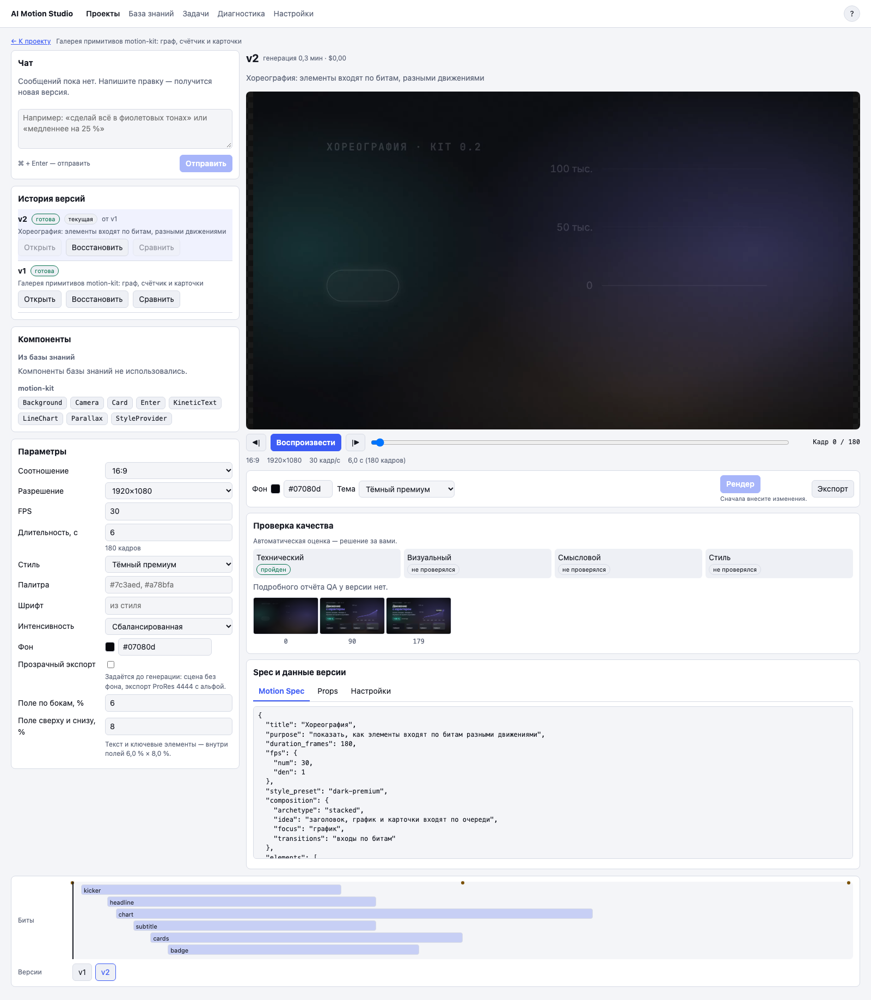

# 2. Motion Playground

## Что это

Motion Playground создаёт одну самостоятельную моушн-сцену. **Версия** — сохранённый результат одной генерации или правки. Старые версии не перезаписываются.

## Когда нужно

Используйте Playground для заставки, схемы, карточки с числом или отдельной вставки. Он также открывается из сценарного и видеопроекта, когда сцену нужно доработать.

## Шаги по экрану

1. На странице «Проекты» введите название.
2. Нажмите «Создать». Откроется проект вида «Сцены».
3. В поле «Что показать» опишите одну мысль. Укажите данные, порядок появления элементов и желаемый итог.
4. При необходимости раскройте «Параметры сцены». Выберите формат, разрешение, стиль и прозрачный фон.
5. Нажмите «Сгенерировать».
6. Следите за этапами и примерным оставшимся временем в карточке задачи.
7. Если появятся уточняющие вопросы, ответьте на них или нажмите «Пропустить».
8. Просмотрите видео справа. Кнопки рядом с ползунком двигают просмотр на один кадр.
9. Проверьте блок QA. QA — автоматическая проверка техники, читаемости, смысла и стиля.
10. Для правки напишите сообщение в чате. Появится новая версия.
11. Для небольшой правки параметров измените настройки и нажмите «Рендер».
12. Нажмите «Экспорт», выберите MP4 или ProRes 4444 с прозрачностью и запустите экспорт.

История версий находится слева. Там можно открыть старую версию, сравнить две версии или восстановить старую как новую.

## Частые проблемы

**«Рендер» недоступен.** Сначала измените хотя бы один параметр. Для видеосцены длительность и FPS задаёт видеопроект, поэтому эти поля доступны только для чтения.

**Нет превью.** Откройте карточку ошибки и технические подробности. Приложение не подменяет неудачную версию старым видео.

**ProRes 4444 недоступен.** Прозрачность нужно включить до генерации. После этого создайте новую версию.

**Правка строится не от той версии.** Если открыта старая версия, выберите базу правки в блоке «База правки».

