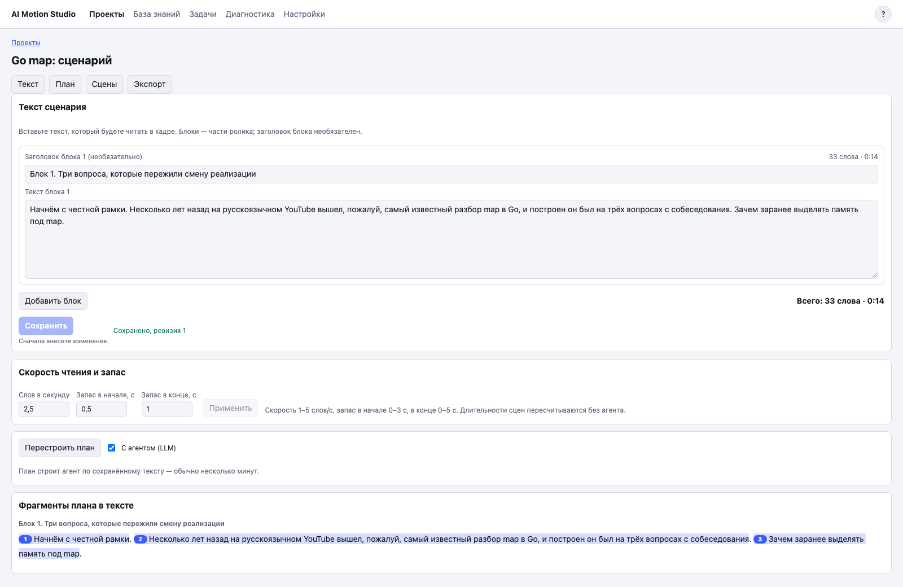
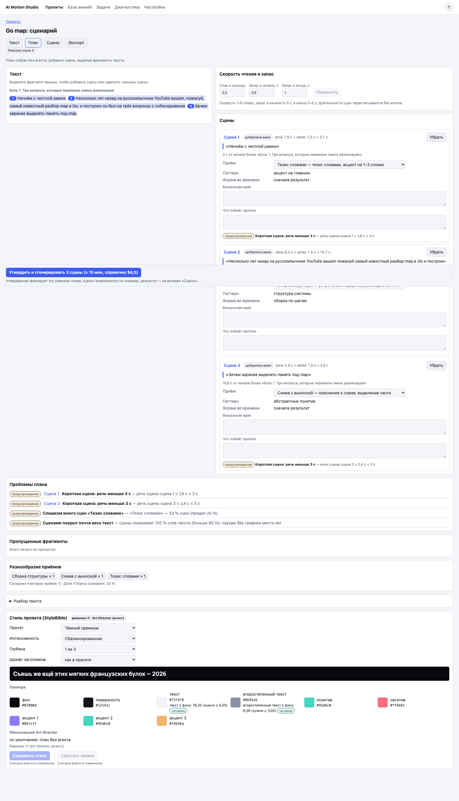

# 3. Сценарий в моушн-сцены

## Что это

Сценарный проект превращает текст ролика в план сцен. **План** связывает каждую сцену с точными словами, длительностью и визуальным приёмом. После проверки план можно утвердить и запустить пакет генерации.

## Когда нужно

Используйте этот путь, если у вас уже есть текст для чтения, но ещё нет исходного видеопроекта.

## Шаги по экрану

1. На странице «Проекты» введите название и нажмите «Сценарий».
2. На вкладке «Текст» вставьте текст. Длинный материал разделите на блоки.
3. Проверьте число слов и расчётное время чтения.
4. Нажмите «Сохранить». Несохранённый текст защищён предупреждением при закрытии вкладки.
5. Нажмите «Построить план».

6. Перейдите на вкладку «План». Прочитайте карточки сцен и список проблем.
7. Исправьте план. Можно принять или отклонить сцену, сменить приём, поменять границы по выделенным словам и добавить сцену по выделению.
8. Убедитесь, что блокирующих проблем нет.
9. Нажмите кнопку утверждения и генерации. В её подписи показаны число сцен и справочная оценка времени и стоимости.

10. На вкладке «Сцены» дождитесь готовности пакета. Сбой одной сцены не удаляет готовые результаты остальных.
11. Нажмите «Доработать в Playground» у сцены, которую нужно исправить. Напишите правку в чате. Новая версия останется привязана к той же сцене плана.
12. На вкладке «Экспорт» выберите `16:9` и нажмите кнопку сборки папки; формат `16:9` будет указан в её подписи.
13. В папке будут MP4, прозрачные версии там, где они поддерживаются, и шпаргалка. Шпаргалка связывает имя файла с фразой сценария.
14. Для вертикальной версии в разделе «Переделать под 9:16» выберите готовые сцены и нажмите кнопку переделки выбранных сцен; в скобках будет указано их число.
15. После готовности вертикальных версий соберите папку `9:16`.

## Частые проблемы

**«Построить план» недоступна.** Сначала сохраните текст.

**Кнопка утверждения и генерации недоступна.** Исправьте блокирующие проблемы, дождитесь сохранения плана и проверьте, что в плане есть принятые сцены и стиль.

**План устарел.** Текст изменился после построения плана. Перестройте план и снова проверьте его.

**Сцена не попала в папку.** На вкладке «Экспорт» показана причина. Обычно нет готовой версии нужного формата.

**Вертикальная версия выглядит тесно.** Откройте её в Playground и проверьте композицию. Перевод в `9:16` создаёт новую сцену, а не просто обрезает края.

