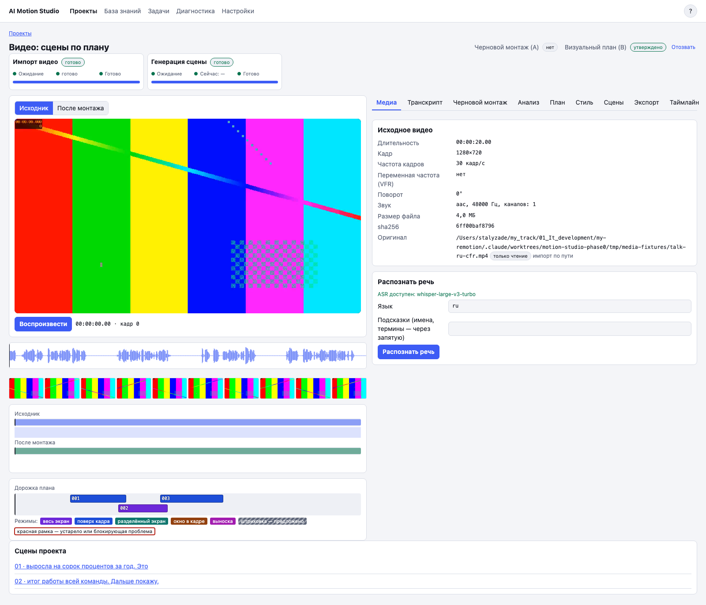

# 4. Видеопроект

## Что это

Видеопроект начинает работу с исходного ролика. Он хранит распознанную речь, черновой монтаж, анализ кадра, визуальный план, моушн-сцены и финальный таймлайн.

**Черновой монтаж** — список оставленных и вырезанных фрагментов. **Утверждение A** фиксирует монтаж. **Утверждение B** фиксирует визуальный план.

## Когда нужно

Используйте видеопроект, когда у вас есть запись ведущего, интервью, урок или другой исходный ролик, поверх которого нужна графика.

## Шаги по экрану

1. На странице «Проекты» введите название и нажмите «Новый видеопроект».
2. На вкладке «Медиа» импортируйте файл. Можно указать разрешённый путь на этом Mac или выбрать файл для загрузки.
3. Дождитесь прокси и служебных файлов. Прокси — облегчённая копия для быстрого просмотра.
4. Запустите распознавание речи. После готовности откройте вкладку «Транскрипт».
5. Исправьте слова при необходимости и сохраните новую ревизию.
6. На вкладке «Черновой монтаж» постройте предложения вырезок. Примите или отклоните каждое предложение.
7. Соберите превью монтажа и прослушайте склейки.
8. Утвердите монтаж кнопкой «Утвердить черновой монтаж (A)».
9. На вкладке «Анализ» нажмите «Анализировать видеоряд» и «Смысловой анализ».
10. На вкладке «План» постройте визуальный план. Проверьте цитаты, режимы размещения и зоны кадра.
11. Исправьте или отклоните проблемные сцены и нажмите «Утвердить визуальный план (B)».

## Частые проблемы

**Импорт не начинается.** Путь должен находиться в одном из разрешённых каталогов импорта. Проще выбрать файл кнопкой загрузки.

**Черновой монтаж недоступен.** Сначала завершите распознавание речи.

**Смысловой анализ недоступен.** Сначала утвердите актуальный монтаж A.

**План нельзя утвердить.** Решите предложенные и устаревшие сцены, затем исправьте блокирующие проблемы.

**После правки монтажа A и B устарели.** Это ожидаемо. Снова утвердите монтаж, перепроверьте план и утвердите B.

