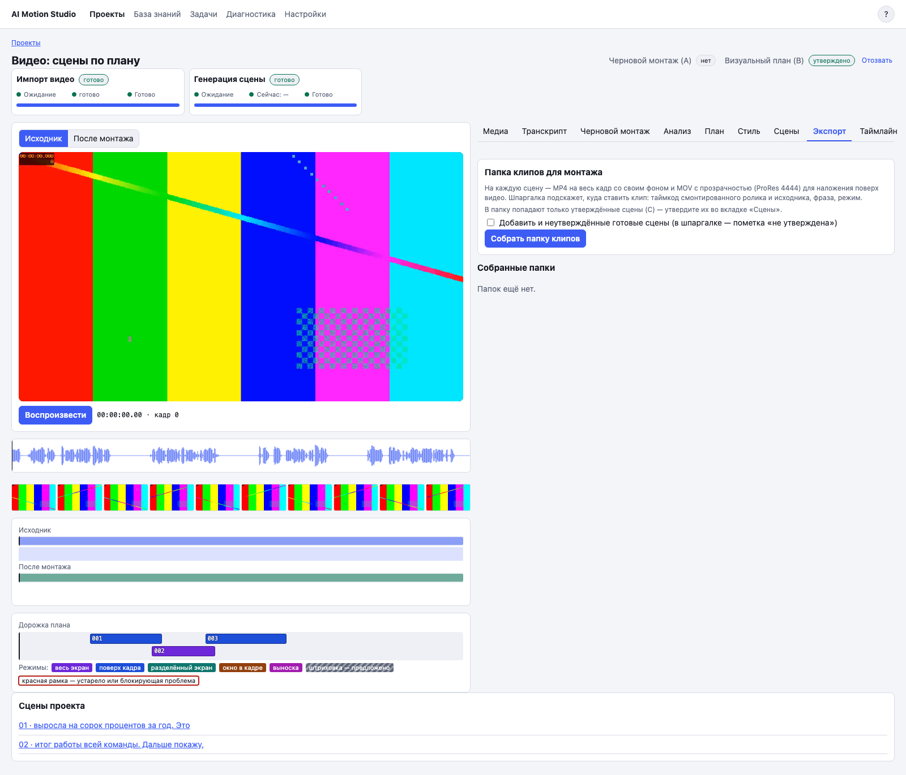

# 5. Сцены видео и утверждение

## Что это

Вкладка «Сцены» создаёт моушн-графику по утверждённому плану B. **Утверждение C** выбирает конкретную версию сцены для таймлайна и папки клипов.

Режим `fullscreen` закрывает исходный кадр полностью. Остальные режимы создаются с прозрачностью и располагают графику в зоне, заданной планом.

## Когда нужно

Переходите сюда после утверждения A и B. На этой вкладке удобно проверить каждую сцену отдельно и поверх исходного видео.

## Шаги по экрану

1. Откройте вкладку «Сцены».
2. Нажмите «Сгенерировать все». Готовые актуальные сцены будут пропущены.
3. Следите за общим прогрессом пакета и статусом каждой плитки.
4. Для готовой сцены переключайтесь между «Сцена» и «В контексте».
5. Если контекст ещё не собран, нажмите «Собрать».
6. Проверьте момент появления, читаемость и то, что графика не закрывает лицо.
7. Нажмите «Доработать», чтобы открыть сцену в Playground. Исправьте её чатом или параметрами.
8. Вернитесь к видео по ссылке «← К видео».
9. Нажмите кнопку утверждения C у нужной версии; в её подписи будет указан номер версии.
10. Если перегенерируете уже утверждённую сцену, подтвердите действие. Старая утверждённая версия останется в истории, а новую нужно будет утвердить отдельно.

На вкладке «Экспорт» можно собрать папку клипов. По умолчанию туда входят утверждённые C версии.

## Частые проблемы

**«Сгенерировать все» недоступна.** Нужен актуальный утверждённый план B.

**Сцена отмечена как устаревшая.** Её слова, режим, зона или длительность изменились в плане. Перегенерируйте сцену и снова утвердите C.

**C устарело после правки.** Утверждение относится к версии, а не ко всей сцене. Просмотрите текущую версию и утвердите её.

**Нужно изменить длительность.** Вернитесь в план и поменяйте границы по словам. На таймлайне длительность не меняется.

**Есть замечания QA.** Откройте их и решите, приемлемы ли они. Интерфейс попросит отдельное подтверждение, если у версии есть блокирующие замечания или отчёт QA не загрузился.

