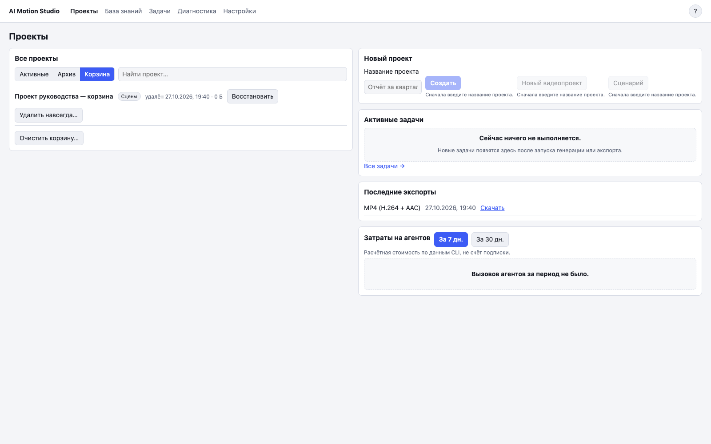

# 7. Проекты и корзина

## Что это

Главная страница хранит активные и архивные проекты, корзину, активные задачи, последние экспорты и справочную стоимость вызовов агентов.

## Когда нужно

Используйте главную страницу для поиска проекта, переименования, архива, восстановления или удаления.

## Шаги по экрану

1. Откройте «Проекты» в верхнем меню.
2. Используйте поиск по названию.
3. Переключайтесь между «Активные», «Архив» и «Корзина».
4. Откройте меню `…` у проекта, чтобы переименовать его, отправить в архив или удалить.
5. При удалении прочитайте сводку. Поле подписано `Для подтверждения введите название проекта: {название}`. Введите текущее название полностью и нажмите «Удалить в корзину».
6. В корзине нажмите «Восстановить», если проект нужен снова.
7. Для окончательного удаления нажмите «Удалить навсегда…» или «Очистить корзину…».
8. Прочитайте сводку, поставьте флажок «Понимаю, что это нельзя отменить» и нажмите «Стереть навсегда».

## Частые проблемы

**Удаление недоступно.** У проекта есть незавершённые задачи. Дождитесь их или отмените в разделе «Задачи».

**Название не принимается.** Введите его полностью, с теми же пробелами и регистром, что в заголовке диалога.

**В корзине включён поиск.** «Очистить корзину…» удаляет все элементы, а не только найденные. Кнопка показывает общее число.

**Восстановление недоступно.** Для этого элемента уже началось окончательное удаление.

