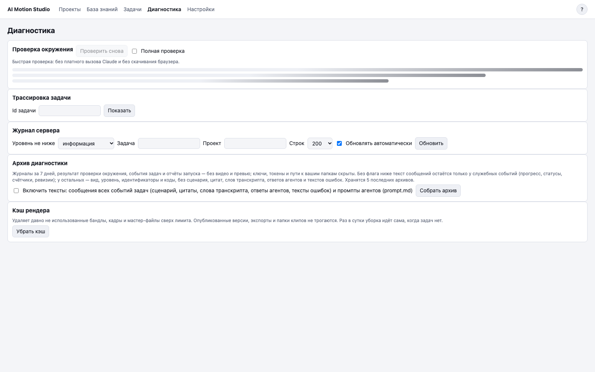

# 8. Диагностика и сбои

## Что это

Раздел «Диагностика» показывает проверку окружения, трассу задачи, журнал сервера, диагностические архивы и очистку кэша. **Кэш** — временные файлы, которые ускоряют повторную работу.

Раздел восстановления появляется после сбоя. Он показывает прерванные и заблокированные задачи, а также черновики в карантине. Карантин — отдельная папка для результата, который нельзя было безопасно опубликовать.

## Когда нужно

Открывайте диагностику, если задача упала, SSD отключился, сервер был завершён аварийно или место на диске заканчивается.

## Шаги по экрану

1. В карточке ошибки прочитайте понятную причину и подсказку.
2. В карточке задачи раскройте «Журнал (N)», где N — число событий. Для черновика в центре восстановления нажмите «Посмотреть журнал». Из карточки ошибки в диагностику ведёт ссылка «Журнал и трассировка».
3. Посмотрите этапы задачи и последние строки журнала.
4. В таблице doctor найдите красную проверку.
5. Для передачи отчёта нажмите «Собрать архив». Включайте промпты только если готовы передать их содержимое.
6. Скачайте готовый архив.
7. Если мало места, нажмите «Убрать кэш». Опубликованные версии, экспорты и папки клипов эта задача не удаляет.

После сбоя откройте центр восстановления из баннера на главной странице. Просмотрите прерванные задачи и журналы карантина. Удаление черновика требует отдельного подтверждения.

## Частые проблемы

**«Хранилище недоступно».** Не создавайте новую папку с тем же именем. Подключите исходный SSD и дождитесь исчезновения баннера.

**Задача заблокирована старым процессом.** Подождите завершения процесса. Если процесс принадлежит другому запущенному серверу, остановите тот сервер. После этого повтор станет доступен.

**Задача долго не меняет этап.** Откройте журнал. Сторож прогресса может завершить зависшую задачу с ошибкой `stalled`; после этого её можно повторить.

**После перезапуска задача снова запустилась.** Это штатное восстановление очереди. Готовые версии не перезаписываются, новая попытка продолжает безопасно.

