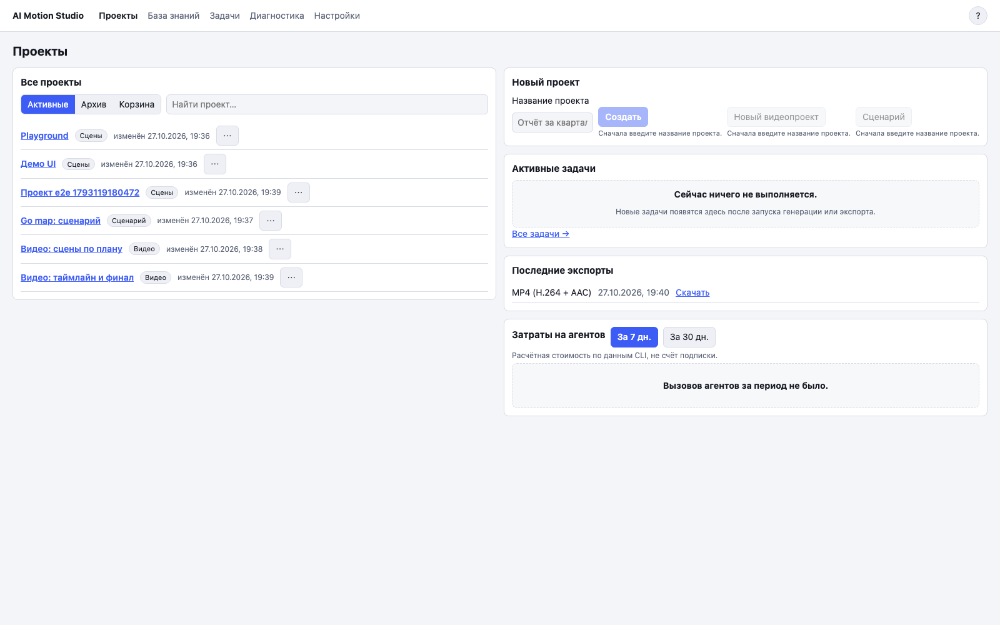
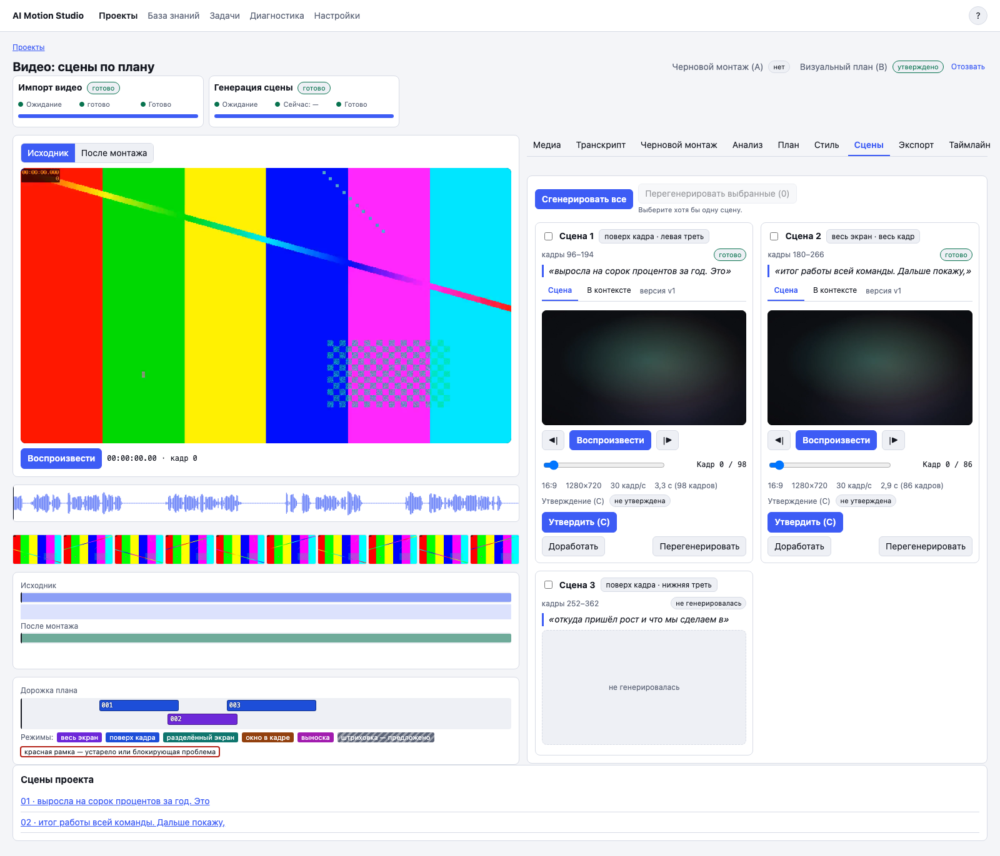
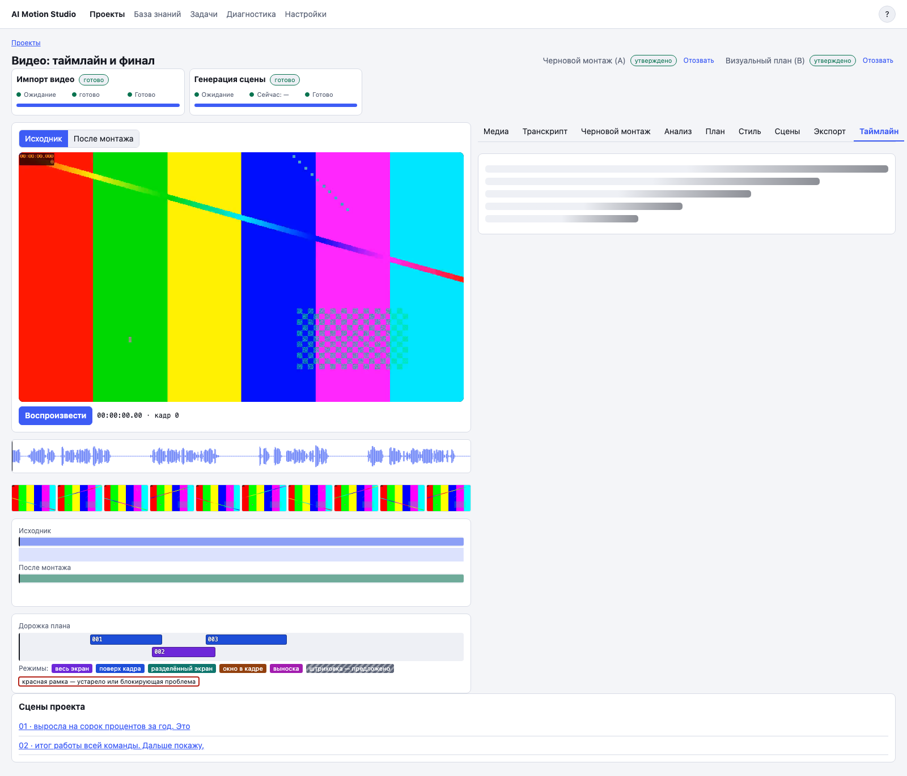

# 9. Сквозной пример: от установки до финального MP4

## Что это

Ниже один полный маршрут для ролика с ведущим. В конце получится финальный MP4, где утверждённые моушн-сцены наложены на смонтированное видео.

## Когда нужно

Используйте этот список как первый рабочий проход и как проверку после переноса приложения на новый Mac.

## 15 шагов

1. Подключите SSD с папкой `/Volumes/External SSD/moution-studio-materials/store`.
2. В корне репозитория выполните `make setup`.
3. Выполните `make run` и откройте `http://127.0.0.1:8790`.
4. На главной странице введите название и нажмите «Новый видеопроект».
5. На вкладке «Медиа» импортируйте исходный ролик и дождитесь подготовки прокси.
6. Запустите распознавание речи. На вкладке «Транскрипт» исправьте ошибки и сохраните текст.
7. На вкладке «Черновой монтаж» постройте предложения вырезок, примите решения, соберите превью и нажмите «Утвердить черновой монтаж (A)».
8. На вкладке «Анализ» выполните анализ видеоряда и смысловой анализ.
9. На вкладке «План» постройте визуальный план, исправьте проблемы и нажмите «Утвердить визуальный план (B)».
10. На вкладке «Сцены» нажмите «Сгенерировать все» и дождитесь завершения пакета.
11. Просмотрите каждую сцену «В контексте». Нужные сцены доработайте в Playground и утвердите их C.
12. На вкладке «Экспорт» соберите папку клипов, если хотите отдельно проверить MP4, прозрачные версии и шпаргалку.
13. На вкладке «Таймлайн» нажмите «Собрать таймлайн». Проверьте дорожки и положение сцен. При необходимости сдвигайте сцены по словам.
14. Соберите превью ревизии. Просмотрите весь ролик. Для изменения длительности вернитесь в план, затем перегенерируйте сцену, утвердите C и пересоберите таймлайн.
15. Нажмите «Экспорт финала…», выберите параметры и затем «Смонтировать и экспортировать». Откройте «Отчёт проверки» и скачайте MP4 из истории экспортов.

## Частые проблемы

**Кнопка следующего шага недоступна.** Прочитайте причину под кнопкой. Обычно нужен сохранённый результат предыдущего шага или актуальное утверждение A, B либо C.

**После правки всё стало «устаревшим».** Это защита от сборки старых данных. Повторите утверждения и пересборку по цепочке от изменённого шага.

**На SSD мало места.** Финальный рендер использует основную копию видео (master-видео), звук и временные файлы. Освободите место через диагностику до запуска экспорта.

**Финал отличается от превью.** Сравните номер ревизии таймлайна в диалоге экспорта и в истории. Превью и финал используют один движок, но должны быть собраны из одной ревизии.

**Нужна помощь.** Откройте «Диагностика», соберите архив и приложите понятное описание последнего действия.

